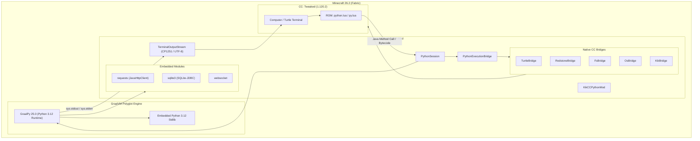

# kik-cc-python (Код и Космос: Python для ComputerCraft)

[](https://minecraft.net/)
[](https://fabricmc.net/)
[](https://tweaked.cc/)
[-yellow.svg)](https://www.graalvm.org/python/)
[](https://adoptium.net/)
[](LICENSE)

**kik-cc-python** — All-In-One (AIO) Fabric-мод для Minecraft 26.2, интегрирующий современный полноценный **Python 3.12 (GraalPy)** в компьютеры и роботы **CC: Tweaked**.

Разработан специально для космического образовательного курса **«Код и Космос»** (KiK).

---

## 🌟 Ключевые возможности

- 🐍 **Полноценный Python 3.12:**
  Современный синтаксис (f-строки, match/case, type hints, walrus operator `:=`).
- 📦 **All-In-One (AIO) сборка:**
  Всё включено в один `.jar` — GraalPy runtime, stdlib и библиотеки. Не требует сторонней установки Python на клиент или сервер.
- 📚 **Богатая стандартная библиотека:**
  `math`, `json`, `random`, `datetime`, `collections`, `itertools`, `re`, `asyncio`, `logging`, `pathlib`, `hashlib` и др.
- 🌐 **Сетевые и прикладные библиотеки:**
  - `requests` — HTTP GET, POST, JSON API с поддержкой `requests.Session()` (на базе неблокирующего Java 11+ `HttpClient`).
  - `sqlite3` — полноценная встроенная SQL база данных в памяти (`:memory:`) или на диске компьютера (на базе `org.sqlite.JDBC`).
  - `websocket` — WebSocket клиент для связи компьютеров с внешними сервисами телеметрии.
- 🇷🇺 **Поддержка русского языка для kik-pack:**
  Автоматическая трансляция кириллицы (UTF-8) в кодировку шрифта CC (CP1251) на лету. Символы русского алфавита корректно отображаются на мониторах и терминалах.
- 🐢 **Нативные ComputerCraft мосты:**
  Прямой доступ к API компьютеров и черепах: `turtle`, `redstone`, `term`, `os`, `fs`, `colors`, `kik`.
- 🛡️ **Песочница и безопасность:**
  Изоляция от хост-системы через GraalVM Polyglot Sandbox и файловую систему CC: Tweaked.

---

## 🏗️ Архитектура



---

## 🎮 Использование в игре

В терминале любого компьютера или черепахи доступны две ROM-команды:

### 1. Интерактивный REPL
Запустите `python` или `py` без аргументов:
```lua
python
```
```text
Python 3.12.8 (GraalPy 25.0) on CC: Tweaked
Type "help", "copyright", "credits" or "license" for more information.
>>> import math
>>> math.sqrt(144)
12.0
>>> import turtle
>>> turtle.forward()
True
>>> exit()
```

### 2. Запуск скрипта
Создайте файл скрипта (например, через `edit rover.py`):
```python
# rover.py
import turtle
import requests

print("Спутник связи запущен...")
for step in range(3):
    turtle.forward()
    turtle.turnRight()

resp = requests.get("https://api.github.com/zen")
print(f"Телеметрия ЦУП: {resp.text}")
```
И запустите его:
```lua
py rover.py
```

### 3. Однострочное выполнение (`-c`)
```lua
py -c "import math; print('Pi =', math.pi)"
```

---

## 🔒 Безопасность и песочница

Для учебных курсов и серверов со студентами критична защита от деструктивных действий:

| Угроза | Решение в kik-cc-python |
|---|---|
| Доступ к файлам сервера (`/etc/passwd`, конфиги) | GraalVM Sandbox запрещает доступ к хостовой FS. Доступны только файлы внутри виртуального диска компьютера (`fs` bridge). |
| Краш сервера (`System.exit(0)`) | Запрещён импорт Java-классов вне белого списка (`allowHostAccess(HostAccess.EXPLICIT)`). |
| Запуск процессов (`subprocess`, `os.system`) | `allowCreateProcess(false)` в контексте Polyglot. |
| Зависание в бесконечном цикле (`while True: pass`) | Кооперативный планировщик выполнения с квантованием тактов (yield/timeout) аналогично Lua в CC. |
| Потребление памяти | Ограничение выделения heap для одного скрипта через ResourceLimits. |

---

## 🛠️ Сборка проекта

### Требования
- **JDK 25** (рекомендуется [Oracle GraalVM 25](https://www.graalvm.org/) или Eclipse Temurin 25).
- Linux / macOS / Windows.

### Сборка стандартного мода (без тяжелых библиотек)
```bash
./gradlew build
```
Выходной файл: `build/libs/kik-cc-python-1.0.0+26.2.jar`

### Сборка All-In-One (AIO) мода
```bash
./gradlew packageAioJar
```
Выходной файл: `build/libs/kik-cc-python-1.0.0+26.2-aio.jar` (~109 MB, содержит GraalPy runtime, stdlib и все зависимости).

### Запуск тестов
```bash
./gradlew test
```
Тестовый набор проверяет:
1. Вычисление базовых выражений и работу стандартных библиотек (`math`, `json`, `random`).
2. Асинхронные корутины (`asyncio`).
3. HTTP запросы и API сессий (`requests.Session`).
4. Базу данных SQLite в памяти (`sqlite3`).
5. Корректность перекодирования русских символов в кодировку CP1251 терминала.
6. Отказоустойчивость мостов черепахи (`TurtleBridge`).

---

## 📋 Проверка качества (minecraft-agent-skills)

Проект полностью валидирован с помощью инструментов [minecraft-agent-skills](https://github.com/jahrome907/minecraft-agent-skills):
- `check-build.sh` — **[PASS]** (Java 25, Fabric 26.2, Gradle 9.5.0 wrapper).
- `validate-test-layout.sh` — **[PASS]** (JUnit Platform 5.11, чистая структура `src/test/java`).

---

## 📄 Лицензия

Проект распространяется под лицензией **GNU LGPL v3**. Подробности в файле [LICENSE](LICENSE).
CC: Tweaked защищён ComputerCraft Public License. GraalVM и Truffle распространяются под Universal Permissive License (UPL).
