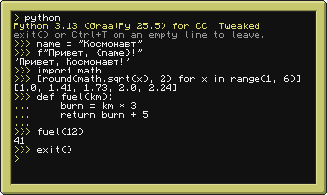
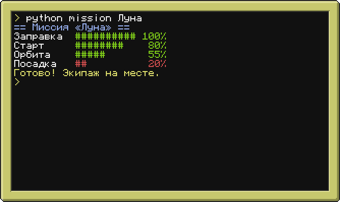
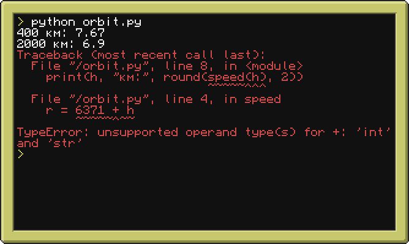
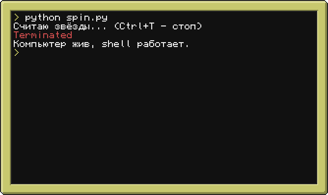
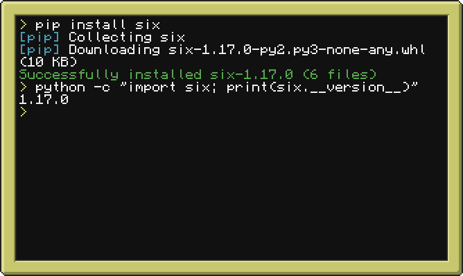
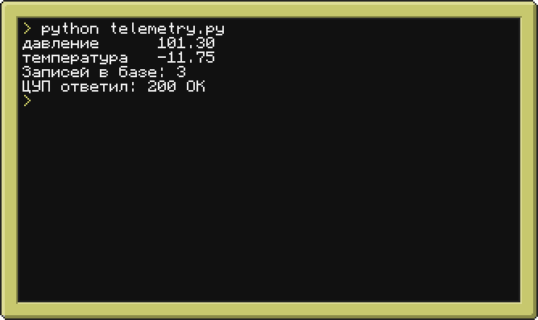
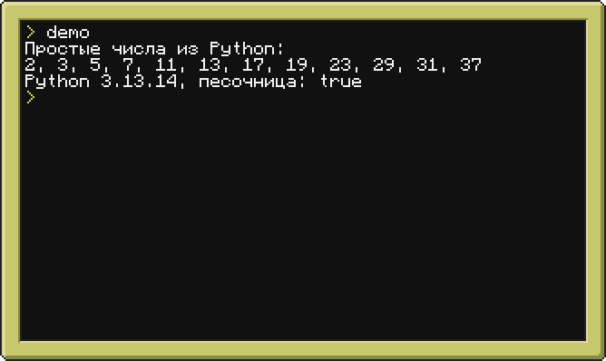
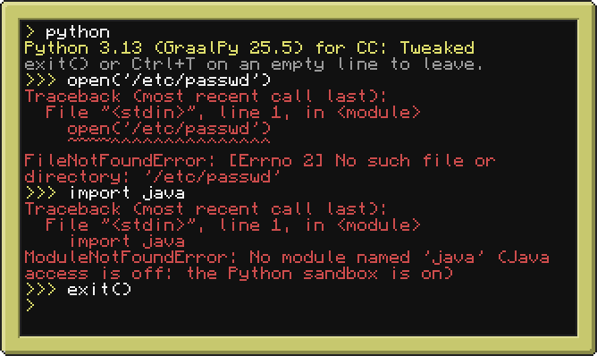

# CC: Python

[](https://minecraft.net/)
[](https://fabricmc.net/)
[](https://neoforged.net/)
[](https://tweaked.cc/)
[-yellow.svg)](https://www.graalvm.org/python/)
[](https://adoptium.net/)
[](LICENSE)
[](https://github.com/BG-D7/cc-python/actions/workflows/build.yml)

**CC: Python** добавляет в компьютеры и черепахи **CC: Tweaked** второй язык — **Python 3.13** (GraalPy 25.5).
Один гибридный JAR для Minecraft 26.2 работает и на **Fabric**, и на **NeoForge**. Мод самостоятельный: GraalPy,
стандартная библиотека и SQLite лежат внутри JAR. Других Python-модов и установленного Python не нужно.

Мод вырос из авторского курса программирования на CC: Tweaked «Код и Космос» и рассчитан на учебные сервера:
песочница, понятные ошибки, кириллица.

---

## Что умеет

- **Python как родной язык CC.** Программа на Python ведёт себя как программа на Lua:
  - пишет в терминал через `term.redirect`, мониторы и `multishell`;
  - останавливается по Ctrl+T;
  - не подвешивает компьютер: Python работает в своём потоке сервера.
- **Песочница по умолчанию.** Скрипт видит только диск своего компьютера и ROM. Нет доступа к файлам сервера,
  Java, процессам и сырым сокетам. Отключается одним ключом конфига для тех, кто понимает риск.
- **`requests` и `websocket`** подчиняются тем же правилам HTTP, что и Lua-API `http`: белый и чёрный списки,
  лимиты размера, вкл/выкл. Правила можно переопределить в конфиге мода.
- **`sqlite3`.** Файл базы лежит на диске компьютера: учитывается в квоте и переезжает вместе с компьютером.
- **REPL.** Переменные живут между строками, выражения печатаются, есть история строк. Ввод, набранный
  до появления приглашения, не теряется.
- **Импорт из папки скрипта**, из `/lib/python`, из пакетов, поставленных `pip`, и из общей серверной папки.
- **Понятные ошибки.** Traceback с номерами строк, печатается один раз.
- **Кириллица везде:** вывод, ввод, аргументы, исходники в UTF-8 или CP1251, строки из Lua. Терминал работает
  в CP1251; кириллический шрифт для клиентов — отдельный [ресурспак](#кириллический-шрифт).
- **`pip install`** ставит pure-Python пакеты (wheel `py3-none-any`) с PyPI с зависимостями и маркерами PEP 508.
  Пакеты ставятся на диск компьютера.

---

## Как это выглядит

| | |
|---|---|
|  |  |
| **REPL**: переменные между строками, эхо выражений, многострочные блоки | **Скрипт** с аргументами и цветом через `term`/`colors` |
|  |  |
| **Traceback** с номерами строк и указателями, один раз | **Ctrl+T** останавливает даже `while True: pass` |
|  |  |
| **`pip install`** pure-Python пакетов на диск компьютера | **`sqlite3`** на диске компьютера и **`requests`** по правилам CC |
|  |  |
| **Lua → Python**: `python.eval` возвращает таблицы | **Песочница**: только диск компьютера, без Java |

<sub>Сцены выполнены на настоящем расширенном компьютере CC: Tweaked (сервер Fabric 26.2). Содержимое терминала
снято через `window.getLine` и отрисовано [кириллическим шрифтом](#кириллический-шрифт) и рамкой CC.</sub>

---

## Установка

1. Сервер или клиент Minecraft **26.2** на **Java 25** с **Fabric** или **NeoForge** и **CC: Tweaked 1.120.2**.
2. Положить `cc-python-<версия>-aio.jar` в `mods/`. Это единственный файл: GraalPy, stdlib и SQLite внутри.
3. На первом запуске рантайм (около 25 МБ) распаковывается в `~/.ccpython-cache/`. Дальше `python` доступен
   на всех компьютерах и черепахах.

Мод нужен только на сервере (в одиночной игре — у клиента). Игрокам на сервер ставить его не нужно.

### Кириллический шрифт

Штатный шрифт CC не содержит кириллицы. Ресурспак `cc-python-cyrillic-<версия>.zip` (папка
[`resourcepack/`](resourcepack/)) заменяет шрифт терминала на вариант с кириллицей в позициях CP1251 — той кодировке,
в которой мод по умолчанию пишет в терминал (`text.encoding = cp1251`).

- Сервер может раздавать его всем игрокам сам: `resource-pack=<URL zip>` и `resource-pack-sha1=<sha1>` в
  `server.properties`. Клиентам ничего ставить не нужно.
- Или каждый игрок кладёт zip в `resourcepacks/`.
- Если кириллица не нужна, поставьте `text.encoding = latin1`: это кодировка штатного шрифта CC.

Шрифт выводит кириллицу. Чтобы набирать её с клавиатуры прямо в CC, нужен ещё драйвер раскладки на Lua, например из
[CCCyrillic](https://modrinth.com/resourcepack/cccyrillic).

Шрифт — производная от шрифта CC: Tweaked с кириллическими глифами из CCCyrillic (sashafiesta) и распространяется
под ComputerCraft Public License, отдельно от мода: [resourcepack/CREDITS.md](resourcepack/CREDITS.md).

---

## Использование в игре

### Программы

| Команда | Что делает |
|---|---|
| `python` / `py` | Интерактивный REPL |
| `python script.py [args…]` | Запуск файла (`.py` можно не писать); путь относительно текущей папки shell |
| `python -c "код" [args…]` | Однострочник |
| `python -m модуль [args…]` | Запуск модуля как `__main__` (`python -m pip list`) |
| `python -V` | Версия |
| `pip install|uninstall|list|freeze|show …` | Пакеты (то же, что `python -m pip`) |

```text
> python
Python 3.13 (GraalPy 25.5) for CC: Tweaked
>>> x = 5
>>> x * 2
10
>>> import turtle
>>> turtle.forward()
True
>>> exit()
```

### Lua API из Python

API компьютера импортируются как модули: `turtle`, `redstone`/`rs`, `term`, `colors`/`colours`,
`peripheral`, `rednet`, `gps`, `textutils`, `settings`, `disk`, `keys`, `window`, `paintutils`, `shell`,
`multishell`, `commands`, `pocket`, `vector`, `help`.

Lua-модули `os`, `fs`, `io` и `http` называются так же, как модули stdlib Python. Поэтому их Lua-версии лежат
под префиксом: `cc.os`, `cc.fs`, `cc.io`, `cc.http`, либо `cc_os`, `cc_fs`.

Имена функций работают в обоих стилях: `turtle.turnRight()` и `turtle.turn_right()`.

```python
import turtle, colors
from cc import lua

turtle.forward()
print(turtle.get_fuel_level(), colors.combine(colors.red, colors.white))
print(lua.eval("return os.getComputerID()"))   # произвольный Lua-код
```

`input()` — это `read()` CC. `time.sleep()` и ожидание событий отдают управление компьютеру. Ctrl+T приходит
в скрипт как `KeyboardInterrupt`. Если скрипт его проглотил или крутится в цикле, через
`limits.terminateGraceMs` он прерывается принудительно. Повторный Ctrl+T прерывает сразу.

### Python из Lua (`python` API)

```lua
local ok, err, printed = python.run("rover.py", { "arg1" }, _ENV)   -- файл
local ok, err = python.execute("print('Привет')")                  -- код
local ok, value = python.eval("{'a': [1, 2.5]}")                    -- значение -> таблица Lua
python.repl(_ENV)
print(python.version(), python.sandboxed())
```

Передавайте `_ENV`, чтобы Python видел `shell`, `require` и другие локальные переменные программы.

### Библиотеки

- `requests`: `get/post/put/patch/delete/head/options`, `Session` (cookies), `Response.json()/text/content`,
  `raise_for_status`, `timeout`, редиректы, исключения в стиле requests.
- `websocket` (API websocket-client): `create_connection`, `WebSocket.send/recv/close`, `WebSocketApp`.
- `sqlite3` (DB-API 2.0):
  - параметры `?` и `:name`, `Row`, транзакции и контекстный менеджер;
  - `executescript`, `iterdump`.
- `pip` / `micropip`. Пакеты ставятся в `/lib/python/site-packages` на диске компьютера.
- Стандартная библиотека Python 3.13 без C-расширений: `json`, `re`, `math`, `random`, `datetime`,
  `collections`, `itertools`, `asyncio`, `dataclasses`, `logging`, `pathlib`, `zipfile` и т. д.

Общие для всего сервера модули и пакеты кладутся в `config/ccpython/libs/`. В Python эта папка видна как
`/rom/python-libs` и не расходует диски компьютеров.

---

## Конфигурация

Файл `config/ccpython/config.properties` создаётся при первом запуске. Изменения применяются без
перезапуска сервера: к новым запускам скриптов.

| Ключ | По умолчанию | Смысл |
|---|---|---|
| `sandbox.disable` | `false` | **Опасно.** `true` снимает песочницу: `import java`, файлы сервера под `/host`, сокеты, процессы. Полный контроль над сервером. |
| `http.enabled` | `inherit` | `requests` вкл/выкл; `inherit` = `http.enabled` из конфига CC |
| `websocket.enabled` | `inherit` | То же для `websocket` |
| `http.rules` | `inherit` | Свои правила вместо правил CC: `action host[:port]` через `;`, первое совпадение побеждает. Пример: `deny $private; allow api.example.com; deny *` |
| `text.encoding` | `cp1251` | Кодировка строк Lua и шрифта: `cp1251` ([кириллический шрифт](#кириллический-шрифт)), `latin1` (штатный шрифт CC), `utf-8` |
| `limits.maxRunSeconds` | `0` | Лимит времени одного запуска, с (0 = нет; REPL не ограничивается) |
| `limits.terminateGraceMs` | `1500` | Сколько ждать реакции на Ctrl+T перед принудительной остановкой |
| `limits.maxSessions` / `limits.maxSessionsPerComputer` | `32` / `4` | Одновременные скрипты на сервер / на компьютер |
| `limits.maxEventQueue` | `256` | Очередь событий скрипта (как у CC) |
| `performance.prewarm` | `true` | Распаковать рантайм и прогреть интерпретатор при старте сервера |

Рантайм GraalPy (около 25 МБ) распаковывается один раз в `~/.ccpython-cache/graalpy-home/<хеш>/`.

---

## Безопасность (песочница)

| Угроза | Что делает мод |
|---|---|
| Чтение и запись файлов сервера | Своя файловая система поверх FS компьютера CC: диск компьютера, его дискеты, `/rom`. Выйти за них нельзя, квота диска соблюдается. |
| Java и краш сервера | `allowHostClassLookup(false)`, `HostAccess` только для аннотированных методов моста, без native access и polyglot. |
| Процессы (`subprocess`, `os.system`) | `allowCreateProcess(false)` |
| Сеть мимо правил | Сырые сокеты запрещены (`PermissionError`). HTTP и websocket проходят только через мост, где действуют правила CC (`$private` и т. п.) или правила конфига. |
| Переменные окружения сервера | `EnvironmentAccess.NONE` |
| Бесконечный цикл, зависший скрипт | Скрипт в отдельном потоке и никогда не блокирует поток CC. Ctrl+T, `limits.maxRunSeconds` и выключение компьютера останавливают его гарантированно, даже во время сетевого запроса. |

Лимита памяти на один скрипт нет: его даёт только общий `-Xmx` сервера.

---

## Сборка и тесты

Нужен **JDK 25**, остальное Gradle скачивает сам: CC: Tweaked и NeoForge (`compileOnly`) из их Maven-репозиториев,
GraalPy и sqlite-jdbc из Maven Central.

GraalPy идёт по ежемесячной линии GraalVM (25.1, 25.2, …; каждый релиз заменяет предыдущий). Версия задаётся в
`gradle.properties` (`graalpy_version`). Пути рантайма (`lib/graalpyA.B`, `lib/pythonX.Y`) и баннер берутся из самого
GraalPy, так что для обновления хватает поменять версию и прогнать тесты. Обычный OpenJDK (как у серверов Minecraft)
исполняет GraalPy без JIT-компилятора Truffle: так было и на 25.0.

Тесты запускаются без `-ea` для пакетов GraalVM (`-da:com.oracle... -da:org.graalvm...`), как на сервере: в 25.5
внутренний assert интерпретатора срабатывает при Ctrl+T (`Context.interrupt`), без `-ea` всё работает.

```bash
./gradlew packageAioJar        # build/libs/cc-python-<версия>-aio.jar (~105 МБ, всё внутри)
./gradlew packageResourcePack  # build/libs/cc-python-cyrillic-<версия>.zip
./gradlew cleanTest test       # JUnit
```

GitHub Actions собирает мод и ресурспак и прогоняет JUnit на каждый push в `main`; файлы лежат в артефактах сборки.

**JUnit** (`PyRunTest`) запускает настоящий GraalPy через Java-заменитель Lua-драйвера и настоящую
`FileSystem` CC на временной папке. Покрыты:
- вывод и кириллица, CP1251-исходники;
- traceback;
- импорт из папки скрипта;
- REPL;
- Ctrl+T: в цикле, во `sleep` и для скрипта, который глотает `KeyboardInterrupt`;
- `maxRunSeconds`;
- песочница;
- sqlite на диске компьютера;
- вызовы Lua API и `eval`;
- правила HTTP, таймаут и Ctrl+T при зависшем ответе сервера;
- `python -m pip`.

**Игровые тесты** идут на отдельном локальном сервере Fabric с этим JAR. Скрипт `startup.lua` на компьютере
прогоняет те же сценарии через настоящий CC:
- `shell.run("python", …)`;
- `parallel` с Ctrl+T;
- REPL с вводом через события;
- `pip install`;
- `requests` и `websocket` в интернет.

Результаты пишутся в файл на диске компьютера. NeoForge локально не тестируется.

---

## Лицензия

Мод — **GNU LGPL v3** ([LICENSE](LICENSE), вместе с текстом GNU GPL v3 в [COPYING](COPYING)).

AIO-JAR включает сторонние компоненты под их собственными лицензиями (GraalPy и Truffle — UPL, стандартная
библиотека Python — PSF, sqlite-jdbc — Apache 2.0 и др.), см. [THIRD-PARTY-NOTICES.md](THIRD-PARTY-NOTICES.md).
CC: Tweaked в мод не входит. Кириллический шрифт — отдельно, под CCPL ([resourcepack/CREDITS.md](resourcepack/CREDITS.md)).
